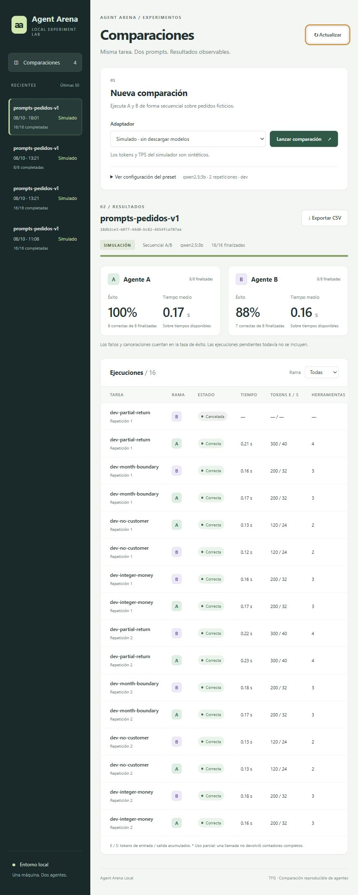

# Agent Arena Local

Memoria de trabajo del TFG. Estado a 12 de octubre de 2026. Los resultados del
primer hito se conservan como evidencia histórica, con sus versiones originales.

## 1. Introducción y motivación

Un agente con herramientas puede producir resultados diferentes al cambiar su
prompt de sistema, aunque se conserve el modelo. Comparar únicamente la respuesta
final oculta el coste de consultas, errores y llamadas adicionales. Este trabajo
aborda la construcción de una plataforma local que permita observar esas
diferencias y conservar evidencia suficiente para repetir el procedimiento.

La ejecución en una sola máquina reduce las necesidades de infraestructura y
facilita el desarrollo por dos personas durante aproximadamente tres meses.
El caso de uso inicial utiliza pedidos ficticios: calcular el gasto de un cliente
en un mes, considerando únicamente pedidos entregados y descontando devoluciones.
No se utilizan datos personales reales en el conjunto de tareas.

## 2. Objetivos y alcance

El objetivo general es comparar dos configuraciones de un agente mediante calidad,
latencia, tokens, uso de herramientas y recursos observables. Se busca separar la
corrección de la respuesta del coste de obtenerla y conservar también los fallos.

El primer hito implementa ocho tareas, tres herramientas, un runner, adaptadores
simulado y Ollama, comparación secuencial, persistencia y exportación. Ambos agentes
deben usar el mismo modelo; los prompts pueden diferir. El simulador permite
verificar el sistema sin descargar modelos. La API expone presets y resultados,
y el worker se ejecuta como proceso independiente.

La interfaz Angular con TypeScript, HTML y CSS permite editar configuraciones,
comparar uno o dos modelos, importar datasets y consultar/exportar resultados.
Incluye cuentas locales, biblioteca de modelos y campañas con diseño fijado e
intentos independientes. Se ha comprobado una comparación real pequeña; falta
una evaluación amplia con casos reservados. Se proponen monitorización periódica,
análisis por tarea e incertidumbre y shadow testing simultáneo. No se implementan Kubernetes,
OpenStack, entrenamiento de modelos ni acceso al razonamiento interno.

## 3. Estado del arte y herramientas relacionadas

Ollama proporciona una API de conversación local con definiciones de herramientas,
respuestas del asistente y contadores de uso [1]. El runner del proyecto utiliza
esa API nativa, evitando una capa de compatibilidad adicional. Su inventario de
modelos expone digest y detalles de cuantización, útiles para documentar la
identidad del modelo instalado [2].

La contribución propuesta se sitúa en la instrumentación y comparación reproducible
de agentes completos, incluyendo herramientas y condiciones de ejecución. Este
apartado todavía no constituye una revisión sistemática del estado del arte.
PENDIENTE: seleccionar trabajos académicos de evaluación de agentes y benchmarks
de uso de herramientas, contrastar sus protocolos y completar la bibliografía.
No se atribuyen resultados publicados que no hayan sido consultados.

## 4. Requisitos del sistema

| Identificador | Requisito | Estado |
| --- | --- | --- |
| RF01 | Configurar A/B con uno o dos modelos y prompts editables | Implementado mediante Angular, JSON y API |
| RF02 | Leer tareas JSONL con referencia a entorno y criterios | Implementado y probado |
| RF03 | Ejecutar herramientas con entornos independientes | Implementado y probado |
| RF04 | Guardar eventos y resultados con estados explícitos | Implementado y probado |
| RF05 | Exportar métricas y evidencia original | Implementado y probado |
| RF06 | Comparación simultánea | Propuesto, pendiente |
| RF07 | Consultar y lanzar comparaciones desde una interfaz web | Verificado con simulación y prueba real pequeña |
| RF08 | Fijar un diseño y conservar intentos independientes en campañas | Implementado; validación en navegador con simulación y pruebas de integración |
| RNF01 | Operar en una máquina sin orquestador de clúster | Verificado con simulador nativo |
| RNF02 | Registrar configuración, datos y versiones | Implementado en snapshots y eventos |
| RNF03 | Limitar tiempo, llamadas y generación | Implementado y probado con simulación |
| RNF04 | Ejecutar con Ollama real y Docker | Implementado, pendiente de validación |

Los contratos Experiment, AgentConfig, Task, Run, Event y ResourceSample rechazan
campos inesperados. Cada ejecución tiene identificador, rama, tarea, repetición,
posición y marcas temporales. Los estados distinguen espera, ejecución, éxito,
fallo, timeout, límite, cancelación e interrupción.

## 5. Arquitectura y decisiones de diseño

La API valida solicitudes y el planificador crea el snapshot y la cola en SQLite.
El worker reclama una ejecución y utiliza el runner para gestionar la conversación.
El adaptador encapsula inferencia; las herramientas encapsulan acceso a pedidos y
aritmética. El evaluador comprueba la respuesta final con criterios que nunca se
incluyen en los mensajes del agente. La exportación consulta evidencia persistida.

La exclusión de otras ejecuciones activas se realiza en una transacción SQLite.
Así se mantiene el modo secuencial incluso con dos workers. Este bloqueo es global:
no representa una arquitectura de alto rendimiento distribuido. Un cierre abrupto
requiere recuperación manual para no repetir silenciosamente trabajo incierto.

Python simplifica la integración entre runner, validación y análisis. Se mantiene
FastAPI para el primer hito. La experiencia declarada del equipo en C#/.NET y
Angular motiva elegir Angular/TypeScript para la interfaz, frente a
React inicialmente previsto; la elección ha sido confirmada e implementada. La separación de API
y worker permite reconsiderar ASP.NET Core sin acoplarlo al bucle del agente.

Cada rama recibe una copia profunda del entorno y un historial nuevo. Sus decisiones
no determinan las llamadas de la otra. Las herramientas de este hito son de lectura
y cálculo; futuros entornos mutables necesitarán ampliar las pruebas de aislamiento.
Las decisiones y alternativas se documentan en [decisiones.md](decisiones.md).

PENDIENTE: incorporar un diagrama de arquitectura con versión exportable como imagen
en `figuras/` cuando se cierre el diseño de la interfaz y monitorización.

## 6. Implementación

Los pedidos incluyen cliente, fecha, estado y líneas con producto, precio, cantidad
y cantidad devuelta. Los precios se expresan en céntimos enteros. El cálculo permite
suma, multiplicación y resta, con validación y límites de tamaño; no ejecuta código
arbitrario. La consulta de líneas devuelve copias para impedir modificaciones
accidentales del entorno desde quien recibe un resultado.

El runner conserva entrada, solicitudes de inferencia, respuestas, llamadas y
resultados de herramientas, duraciones y errores. No necesita razonamiento privado
del modelo. El adaptador Ollama retira el campo de thinking antes de persistir la
respuesta. Las respuestas finales deben ser JSON con total_cents y order_ids.

El presupuesto de generación se comparte entre todas las llamadas de una ejecución.
El runner envía el presupuesto restante al servidor, controla truncamientos y suma
contadores no negativos. Si una llamada falla sin contadores, los totales disponibles
son parciales y el TPS agregado queda no disponible. Un error de herramienta se
devuelve al agente y se registra; puede recuperarse siempre que el resultado final
y las restricciones sean correctos.

La cancelación se comprueba durante las esperas al adaptador y entre herramientas.
El timeout limita la espera de inferencia; no demuestra que el servidor haya dejado
de generar después de desconectarse el cliente. Las herramientas actuales son
locales, breves y acotadas; PENDIENTE: aislamiento de proceso para herramientas
externas que puedan bloquear. El estado final y su evento se guardan atómicamente.

Los snapshots conservan configuración efectiva, tareas, datos, hashes, fuentes del
motor, versiones de paquetes, sistema y política de ejecución. Los eventos añaden
versión de Ollama, metadatos del modelo y observaciones de recursos. Un nuevo
experimento conserva el anterior; las exportaciones no sobrescriben directorios.

### 6.1. Interfaz de comparación

El frontend utiliza Angular 20.3.33, TypeScript 5.9.3 y plantillas HTML con CSS
propio. Las versiones se eligieron por compatibilidad con Node 22.16.0 [3]. Los
componentes standalone y signals gestionan el estado visible, y un servicio tipado
separa las solicitudes HTTP de la presentación. El historial expone resúmenes,
evitando descargar todos los snapshots para construir la navegación.

La pantalla permite elegir un preset, lanzar una comparación y seguir su progreso.
Dos tarjetas muestran éxito y tiempo medio por rama; una tabla ofrece estados,
tokens, duración y herramientas por ejecución. El usuario puede filtrar por rama,
consultar eventos y respuesta final, solicitar una cancelación o descargar el CSV.
Las configuraciones se consultan, pero todavía se editan en archivos JSON.

El polling de la comparación seleccionada se activa solo mientras haya ejecuciones
no terminales, con un intervalo de 2,5 segundos y sin peticiones de actualización
solapadas. Las selecciones usan identificadores de solicitud para evitar que una
respuesta antigua sustituya la comparación actual. Los errores de conexión se
muestran manteniendo los resultados previos como potencialmente desactualizados.

La tasa de éxito visible utiliza ejecuciones terminales y conserva cancelaciones
y fallos en su denominador. Un tiempo ausente se muestra como «—»; la media solo
considera tiempos disponibles. El frontend distingue la simulación de Ollama y
advierte de que sus tokens son sintéticos. La API y el worker siguen separados.

Figura 1. Historial, lanzamiento, progreso, métricas A/B y tabla de ejecuciones.
Los datos corresponden a una prueba funcional simulada con una cancelación
intencionada en B; la diferencia de éxito no representa calidad de los prompts.

## 7. Metodología experimental y métricas

El diseño inicial es emparejado por tarea y repetición. Ambas ramas reciben la misma
entrada y datos iniciales. El orden A/B se aleatoriza con una semilla registrada.
La semilla del modelo es un parámetro independiente, enviado cuando existe; no se
promete determinismo entre versiones, hardware o ejecuciones del servidor.

La evaluación separa formato y éxito. El formato exige tipos estrictos y ausencia
de campos extra. El éxito requiere importe e IDs correctos, sin IDs repetidos, y
respeto de herramientas permitidas. No impone una trayectoria: las ramas del
simulador consultan pedidos en órdenes opuestos y pueden obtener el mismo éxito.

| Métrica | Definición y alcance |
| --- | --- |
| Tasa de éxito | Ejecuciones correctas entre todas las ejecuciones terminales, incluidos fallos y cancelaciones |
| Cumplimiento de formato | Respuesta aceptada por el contrato JSON estricto |
| Tiempo del agente | Reloj monótono del runner, incluye consultas de metadatos e instrumentación |
| Tiempo en cola | Diferencia entre inicio y creación de la ejecución |
| Tokens | Suma de entrada y salida comunicada por todas las respuestas recibidas |
| TPS del servidor | Salida acumulada dividida por duración acumulada de generación del servidor |
| Rendimiento del agente | Salida acumulada dividida por duración total del runner |
| Herramientas | Intentos, tiempo acumulado y errores |
| Recursos | RAM disponible y RSS del worker; memoria GPU global si NVML está disponible |

El TPS del servidor se calcula con duraciones en nanosegundos convertidas a segundos
[1]. No se promedian TPS de llamadas sin ponderar. Los contadores del simulador son
sintéticos y únicamente prueban la agregación. Las muestras de recursos se toman
al principio y al final; no permiten estimar picos ni energía. No se atribuye consumo
de una GPU compartida a una rama.

El resumen utiliza pandas para emparejar resultados y SciPy para un test exacto de
McNemar cuando solo hay una repetición y pares discordantes. Con repeticiones se
omite el valor p para evitar asumir independencia entre observaciones de una tarea.
PENDIENTE: intervalos de confianza, análisis de latencias emparejadas y estimación
de variabilidad agrupada por tarea. Un conjunto sintético pequeño no permite
generalizar a una población de consultas reales.

Se distinguen cuatro tareas de desarrollo y cuatro de evaluación. Comparten el
dominio y entorno sintético, por lo que esta separación es procedimental y no
demuestra generalización a distribuciones nuevas. PENDIENTE: ampliar y congelar
un conjunto de evaluación independiente antes de ajustar prompts con modelos reales.

## 8. Experimentos y resultados

### 8.1. Equipo y procedimiento

La ejecución nativa utiliza Python 3.11.9 sobre Windows 11 Home, compilación
10.0.26200. psutil informa 33.959.383.040 bytes de RAM total (aproximadamente
31,6 GiB) y 32 procesadores lógicos. El identificador de CPU registrado es Intel64
Family 6 Model 183 Stepping 1. La cadena de platform de Python aparece como
Windows-10; la consulta del sistema operativo identifica Windows 11 Home.

La consulta nvidia-smi falla por permisos y NVML no está instalado en el entorno.
PENDIENTE: confirmar GPU, VRAM y controlador. Ollama y Docker no se localizaron
en PATH durante la inspección; esto no demuestra que no existan en otra ubicación.
Las versiones exactas del entorno están en requirements.lock y en cada snapshot.

### 8.2. Validación automatizada

Se han ejecutado 43 pruebas con pytest, todas satisfactorias. Cubren las ocho
tareas, aislamiento de datos y resultados, rutas distintas A/B, rechazo de importes
incorrectos y formatos ambiguos, restricciones, operaciones seguras, acumulación
de métricas, límites, timeouts, errores de herramientas, cancelación, interrupción,
recuperación, API, exportación, snapshots sin Git y payload HTTP nativo simulado.
La ampliación de interfaz verifica el catálogo de presets, el historial, su orden,
los límites de consulta y los contadores de finalización después de cancelar.

La instalación editable del paquete se ha verificado. La batería emite una
advertencia de deprecación de TestClient de Starlette con AnyIO; no impide la
ejecución, pero debe revisarse al actualizar dependencias. Estas pruebas no
constituyen validación de un modelo real ni de Docker.

### 8.3. Comparación simulada inicial

Se conserva el experimento inicial en
[experiments/simulated-dev-2026-10-08](../experiments/simulated-dev-2026-10-08/summary.json).
Utiliza cuatro tareas de desarrollo, dos ramas, dos repeticiones y semilla de orden
42: dieciséis ejecuciones, ocho pares. Ambas ramas alcanzaron éxito en todas ellas.
No hubo pares discordantes. El resultado verifica el recorrido funcional del
simulador; no evidencia superioridad de un prompt ni calidad de qwen2.5:3b, que
no fue ejecutado. Los tokens y tiempos de generación declarados por el simulador
no son mediciones de un LLM.

La carpeta conserva métricas CSV, ejecuciones JSON, eventos JSONL y snapshot.
Esta primera exportación precede a los últimos ajustes de robustez; se mantiene
como evidencia histórica con sus hashes.

### 8.4. Validación del código del primer hito, 8 de octubre

Tras los ajustes de robustez se ejecutaron nuevamente los presets. Los hashes de
fuentes de ambos snapshots coinciden con el motor del primer hito. La ampliación
posterior de la API para el frontend queda identificada en la prueba de interfaz.

| Conjunto | Repeticiones | Ejecuciones | Éxitos A | Éxitos B | Evidencia |
| --- | --- | --- | --- | --- | --- |
| Desarrollo, cuatro tareas | 2 | 16 | 8/8 | 8/8 | [Resumen](../experiments/simulated-dev-final-2026-10-08/summary.json) |
| Evaluación, cuatro tareas | 1 | 8 | 4/4 | 4/4 | [Resumen](../experiments/simulated-eval-2026-10-08/summary.json) |

Todas estas ejecuciones utilizaron el adaptador simulado. Se verificó también la
consistencia de dependencias mediante pip check, sin incompatibilidades declaradas.
En esa fecha quedaba pendiente la comparación real; la validación posterior se
describe en el apartado 8.6. Siguen pendientes mediciones de hardware continuas.

### 8.5. Validación inicial de la interfaz, 8 de octubre

Se verificó `npm run build` con Node 22.16.0 y npm 10.9.2. El bundle inicial final
ocupa aproximadamente 226 kB sin comprimir (estimación de transferencia: 63,5 kB).
La instalación de dependencias no reportó vulnerabilidades conocidas en npm audit
en el momento de ejecutarse; esto no sustituye futuras revisiones.

La prueba en navegador recorrió el lanzamiento simulado, actualización automática,
cancelación en cola, filtro B, apertura de trazas y descarga CSV. Se lanzaron
dieciséis ejecuciones; una de B se canceló intencionadamente y las quince restantes
terminaron correctamente. A obtuvo 8/8 y B 7/8: 100 % y 87,5 % respectivamente
(la tarjeta redondea B a 88 %). La evidencia se conserva en
[ui-smoke-2026-10-08](../experiments/ui-smoke-2026-10-08/summary.json).
Su finalidad es validar la interfaz y el tratamiento de fallos, no comparar prompts.

La presentación se inspeccionó en el navegador de escritorio y en un viewport
móvil de 390 px. Se corrigieron un desbordamiento horizontal y la presentación de
tiempos ausentes. La tabla conserva su desplazamiento horizontal dentro del panel.
PENDIENTE: suite de regresión visual automatizada y validación de accesibilidad
completa. En esta prueba inicial no se ejecutó Ollama desde la interfaz. Los
porcentajes citados corresponden a esa versión histórica; la interfaz actual
separa aciertos, respuestas evaluadas y errores, mostrando sus denominadores.

### 8.6. Validación integral y campañas, 12 de octubre

La [validación integral](validacion-integral-2026-10-12.md) recorre inicio de sesión,
importación del CSV existente, ejecución, biblioteca y descarga de CSV, Markdown
y JSON en una base aislada. Se ejecutaron tres casos de desarrollo con qwen2.5:3b
y qwen2.5:7b: 2/3 y 3/3 aciertos, respectivamente, sin errores de ejecución.
La diferencia fue `Paris` frente a la referencia exacta `París`. Este resultado
no demuestra superioridad general y no autoriza una conclusión estadística.
Las versiones, parámetros, datos, fuentes y limitaciones constan en el informe.

Las [campañas](campanas.md) fijan datos, referencias, prompts, parámetros, fase y
condiciones declaradas. Cada intento crea resultados nuevos; el original permanece
intacto. Las identidades reales se verifican antes de enviar entradas y se indican
cambios de código o equipo. La evolución no agrega repeticiones como observaciones
independientes ni calcula un ganador. La prueba de navegador de esta funcionalidad
repite el benchmark simulado: dos intentos de 16 ejecuciones, 8/8 aciertos por rama.
La fijación de digest/servidor se verifica con adaptadores controlados.

Controles actuales: 188 pruebas Python, 22 del frontend, compilación de producción
y comprobación de dependencias. Se comprobaron recarga, recuperación de API y
vista móvil de campañas a 320/390 px; la accesibilidad completa sigue pendiente.

## 9. Limitaciones y amenazas a la validez

La principal limitación es el tamaño y alcance reducidos de la evaluación real. El simulador
reconoce un formato de entrada y una pauta de orden concreta; no interpreta lenguaje
natural de forma general. Su éxito no estima el éxito futuro del adaptador Ollama.

La caché, el calentamiento, el orden y la carga externa pueden alterar las latencias.
El modo secuencial evita competencia interna entre ramas, pero no controla otros
procesos del equipo. La política sin warmup permite efectos de primera carga que
deberán tratarse explícitamente. El muestreo de recursos es discontinuo y la memoria
del worker no representa memoria del servidor de inferencia.

El evaluador comprueba resultados y herramientas permitidas; no demuestra que el
agente haya justificado correctamente cada operación. Las tareas son pequeñas y
visibles en el repositorio. La recuperación de procesos muertos es manual. SQLite
y la API con sesiones de cuentas locales se destinan al entorno local de investigación.
Docker y Python 3.12 no han sido verificados. PENDIENTE: controles de truncamiento
de contexto y compatibilidad específica de herramientas para el modelo elegido.

## 10. Conclusiones y trabajo futuro

Se dispone de un recorrido funcional y probado para comparar agentes simulados,
conservando configuraciones, trazas, métricas y fallos. La arquitectura permite
sustituir el simulador por el adaptador Ollama sin cambiar herramientas ni evaluador.
La evidencia disponible respalda el funcionamiento de la plataforma bajo pruebas
controladas, sin permitir todavía conclusiones sobre rendimiento de modelos.

La siguiente prioridad es ampliar la evaluación con casos reservados y revisados,
añadir análisis por tarea e incertidumbre y definir una política de calentamiento
para estudiar latencias. Las campañas facilitan repetir diseños conservando la
evidencia. Quedan pendientes muestreo periódico y estado del worker. El modo simultáneo deberá etiquetar competencia por recursos y conservar
la independencia de ramas. PENDIENTE: acordar planificación de los dos autores y
reservar tiempo para experimentos, análisis y redacción final.

## 11. Referencias

[1] Ollama. “Generate a chat message”. Documentación oficial de la API.
<https://docs.ollama.com/api/chat>. Consultado el 8 de octubre de 2026.

[2] Ollama. “List models”. Documentación oficial de la API.
<https://docs.ollama.com/api/tags>. Consultado el 8 de octubre de 2026.

[3] Angular. “Version compatibility”. Documentación oficial.
<https://angular.dev/reference/versions>. Consultado el 8 de octubre de 2026.

PENDIENTE: incorporar referencias académicas verificadas y adaptar el estilo
bibliográfico a la normativa de la universidad.

## 12. Anexos e instrucciones de reproducción

El [README](../README.md) contiene instalación fijada, comandos nativos, API,
worker, recuperación, exportación y preparación de Ollama. Los datos originales
están en [data](../data/tasks.jsonl) y los presets en [configs](../configs/simulated.json).
Para conservar evidencia, cada exportación debe utilizar una carpeta nueva bajo
`experiments/`. Las figuras y sus versiones exportables se guardan en
`docs/figuras/`; se incluye una captura PNG de la primera interfaz Angular.

Para reproducir la interfaz se inicia FastAPI en el puerto 8000, el worker en
otro proceso y `npm start` desde frontend en el puerto 4200, después de `npm ci`.
El proxy de desarrollo conserva el mismo origen en el navegador. El build de
producción necesita un servidor estático y proxy equivalentes; no está integrado
en Compose todavía. Las pruebas funcionales de UI constan en
[frontend/VERIFICACION.md](../frontend/VERIFICACION.md).

Antes de una campaña real deben registrarse hardware, modelo y cuantización,
versiones, configuración, conjunto de tareas, procedimiento, repeticiones, orden,
condiciones térmicas/carga de fondo y ubicación de resultados. El snapshot automatiza
parte de ese registro; las condiciones externas necesitan anotación del operador.

PENDIENTE: recibir plantilla, normativa de la universidad, título definitivo,
datos de autoría y tutoría. La estructura Markdown utiliza encabezados, párrafos y
tablas simples para permitir una futura conversión a Word sin depender del chat.
